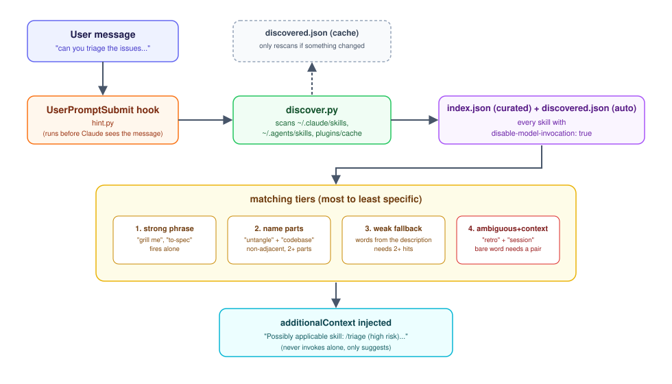
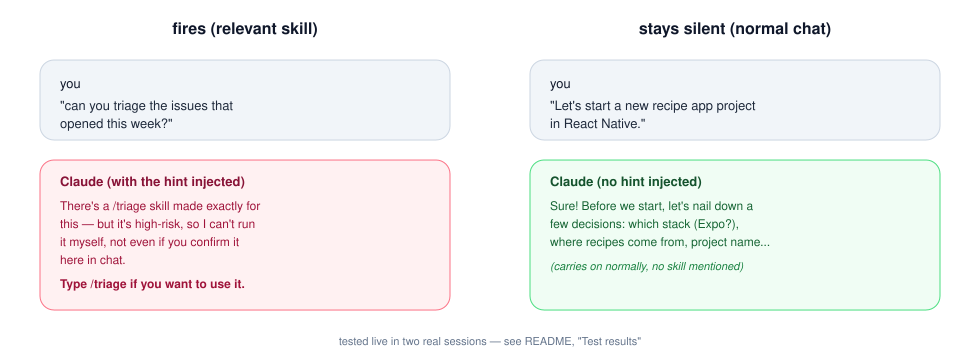

# skill-radar

Um hook do Claude Code que detecta sozinho, antes de cada mensagem sua, quando um pedido bate com uma skill instalada que **não pode ser chamada automaticamente** (`disable-model-invocation: true`) — e injeta um aviso de uma linha pro Claude, pra ele te sugerir o comando certo em vez de explicar o mecanismo do zero toda vez.

Não precisa de lista manual por skill: ele escaneia de verdade `~/.claude/skills`, `~/.agents/skills` e `~/.claude/plugins/cache`, lê o frontmatter de cada `SKILL.md`, e qualquer skill nova que você instalar — sua, de plugin, ou de qualquer pacote — já entra no radar sem editar nada.

## Como funciona



1. Você digita uma mensagem.
2. O hook `UserPromptSubmit` roda `hint.py` **antes** do Claude processar a mensagem.
3. `discover.py` escaneia os diretórios de skills (com cache: só re-escaneia se algum `SKILL.md` mudou) e filtra as que têm `disable-model-invocation: true`.
4. `hint.py` junta esse resultado com `index.json` (curadoria manual, mais precisa em português para as skills que já conhecemos) e tenta casar sua mensagem contra 4 camadas de correspondência, da mais pra menos específica:
   - **Frase forte**: um trecho que só faz sentido se for aquele pedido ("grill me", "to-spec").
   - **Partes do nome**: todas as partes de um nome composto aparecem na mensagem, mesmo não-adjacentes ("untangle" ... "codebase").
   - **Fallback fraco**: palavras tiradas da própria descrição da skill, já filtradas pra tirar as genéricas demais; precisa de 2+ acertos.
   - **Ambígua + contexto**: uma palavra do dia a dia que também é nome de skill ("retro", "triagem", "wayfinder") só dispara se vier **junto** com uma palavra de projeto/dev (`issue`, `ticket`, `pr`, `bug`, `sessão`, `spec`...). Essa regra é genérica — qualquer skill nova com nome de palavra única já nasce protegida, sem eu precisar notar o caso.
5. Se bateu, injeta um `additionalContext` de uma ou duas linhas dizendo qual skill parece aplicável e lembrando que, sendo `disable-model-invocation: true`, só você digitando o comando dispara de verdade — nunca o Claude sozinho, mesmo que você confirme em texto.

## Exemplo



## Instalação

Requer `python3` (com `pyyaml`, opcional — tem fallback sem ele) no PATH.

```bash
git clone <url-deste-repositorio> skill-radar
cd skill-radar
./install.sh
```

O `install.sh`:
- copia `hint.py`, `discover.py` e `index.json` para `~/.claude/skill-radar/`;
- mescla (sem sobrescrever o resto) um hook `UserPromptSubmit` em `~/.claude/settings.json`;
- é idempotente — rodar de novo não duplica a entrada, só atualiza o caminho.

Depois de instalar, **abra uma sessão nova** do Claude Code — o hook só é lido na inicialização da sessão.

### Instalação manual (sem o script)

Se preferir não rodar `install.sh`, copie os três arquivos pra qualquer pasta e adicione isto em `~/.claude/settings.json` (mesclando com o que já existir em `hooks`, nunca substituindo):

```json
{
  "hooks": {
    "UserPromptSubmit": [
      {
        "hooks": [
          {
            "type": "command",
            "command": "python3 \"/caminho/absoluto/para/hint.py\"",
            "timeout": 5
          }
        ]
      }
    ]
  }
}
```

## Desinstalação

Remova a entrada em `hooks.UserPromptSubmit` do `~/.claude/settings.json` e delete `~/.claude/skill-radar/`.

## Estendendo / corrigindo um falso positivo

- **Skill nova, sem curadoria manual:** já funciona sozinha (frases entre aspas na descrição da própria skill + nome + fallback). Nada a fazer.
- **Quer melhorar a precisão de uma skill específica:** edite `index.json`. Campos aceitos por skill:
  - `keywords`: frases que disparam sozinhas (uma por linha, sem precisar ser a frase inteira — é checado por `in`, substring).
  - `risk`: `"alto"` muda a mensagem pra reforçar que não dá nem com "sim" verbal do usuário (reservado pra skills já auditadas manualmente quanto a ações destrutivas/externas sem confirmação).
  - `ambiguous_keywords` + `context_words`: palavras extras de contexto específicas da skill, somadas às genéricas (`GENERIC_CONTEXT_WORDS` em `hint.py`).
- Depois de editar `index.json`, nada mais precisa ser feito — `hint.py` lê o arquivo a cada chamada.

## Limitações conhecidas

- Não cobre skills *model-invoked* (sem `disable-model-invocation: true`) — essas o Claude já pode chamar sozinho, então não precisam de aviso.
- A camada de fallback fraco usa palavras da descrição em inglês (a maioria dos `SKILL.md` instalados é em inglês); para pedidos inteiramente em português sem o nome da skill, a camada que realmente carrega o peso é "partes do nome" e "ambígua + contexto", não o fallback.
- Roda localmente, sem chamada de LLM nem rede — mais rápido e mais previsível, mas não entende sinônimo nem intenção fora do que está escrito aqui.
- O watcher de configurações do Claude Code só observa pastas que já tinham `settings.json` quando a sessão abriu — por isso é preciso uma sessão nova após instalar/atualizar.

## Resultados dos testes

Bateria de 28 casos (uma skill de cada vez, início de projeto, meio de projeto, e armadilhas de palavra ambígua) + 8 casos extras de borda + 1 caso sintético com uma skill nunca vista antes (`polish`, pra provar que a proteção é genérica, não curada caso a caso): **todos passando**. Validado também em produção, rodando numa sessão real do Claude Code (não só via script).

## Por que existe

Nenhuma skill ou plugin publicado faz exatamente isso — escanear o disco de verdade em busca de `disable-model-invocation: true`, via hook determinístico, sem chamada de LLM e sem lista de palavra-chave fixa. O mais parecido em mecanismo manda o prompt pra um servidor externo; os outros são `SKILL.md` que o próprio modelo lê (custam contexto a cada vez) ou têm catálogo fixo em vez de escanear o disco.

## Licença

MIT — veja [LICENSE](LICENSE).
