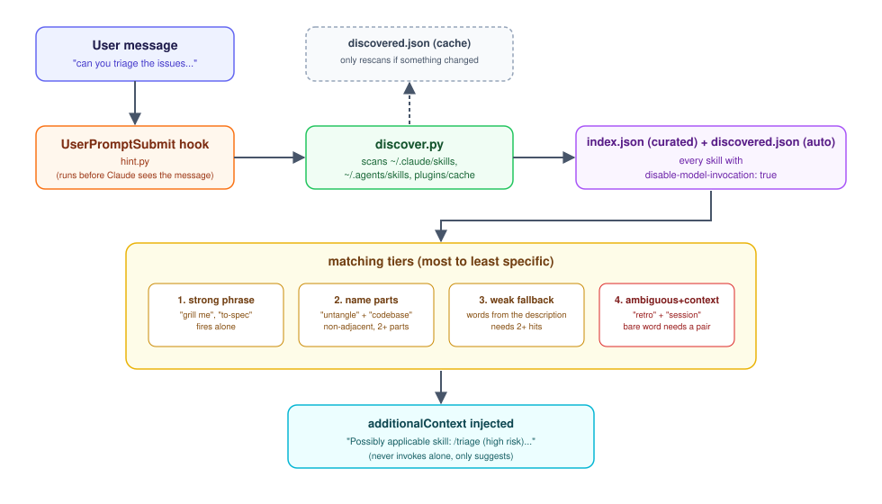
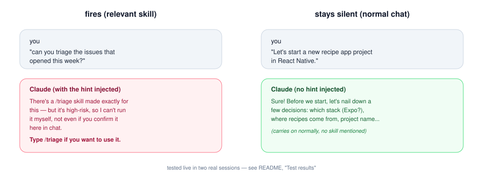

# skill-radar

*[Read in English](README.md)*

Um hook do Claude Code que detecta sozinho, antes de cada mensagem sua, quando um pedido bate com uma skill instalada que não pode ser chamada automaticamente (`disable-model-invocation: true`). Ele injeta um aviso de uma linha pro Claude, pra ele te sugerir o comando certo em vez de explicar o mecanismo do zero toda vez.

Não precisa de lista manual por skill: ele escaneia de verdade `~/.claude/skills`, `~/.agents/skills` e `~/.claude/plugins/cache`, lê o frontmatter de cada `SKILL.md`, e qualquer skill nova que você instalar (sua, de plugin, ou de qualquer pacote) já entra no radar sem editar nada.

## Como funciona

*(diagramas em inglês, pra ficar consistente com o resto do código/repositório)*



1. Você digita uma mensagem.
2. O hook `UserPromptSubmit` roda `hint.py` antes do Claude processar a mensagem.
3. `discover.py` escaneia os diretórios de skills (com cache, só re-escaneia se algum `SKILL.md` mudou) e filtra as que têm `disable-model-invocation: true`.
4. `hint.py` junta esse resultado com `index.json` (curadoria manual, mais precisa em português para as skills que já conhecemos) e tenta casar sua mensagem contra 4 camadas de correspondência, da mais pra menos específica:
   - **Frase forte**: um trecho que só faz sentido se for aquele pedido ("grill me", "to-spec").
   - **Partes do nome**: todas as partes de um nome composto aparecem na mensagem, mesmo não adjacentes ("untangle" ... "codebase").
   - **Fallback fraco**: palavras tiradas da própria descrição da skill, já filtradas pra tirar as genéricas demais; precisa de 2+ acertos.
   - **Ambígua + contexto**: uma palavra do dia a dia que também é nome de skill ("retro", "triagem", "wayfinder") só dispara se vier junto com uma palavra de projeto/dev (`issue`, `ticket`, `pr`, `bug`, `sessão`, `spec`...). Essa regra é genérica: qualquer skill nova com nome de palavra única já nasce protegida, sem eu precisar notar o caso.
5. Se bateu, injeta um `additionalContext` de uma ou duas linhas dizendo qual skill parece aplicável e lembrando que, sendo `disable-model-invocation: true`, só você digitando o comando dispara de verdade, nunca o Claude sozinho, mesmo que você confirme em texto.

## Exemplo



## Instalação

Escolha SÓ UM dos três métodos abaixo. Todos acabam registrando o mesmo hook, então combinar mais de um só faz o aviso ser injetado em dobro.

### Opção A: como plugin do Claude Code (recomendado)

```
/plugin marketplace add HDharder/skill-radar
/plugin install skill-radar@skill-radar
```

Usa o próprio sistema de plugins do Claude Code: sem passo de setup em Python, sem editar `~/.claude/settings.json` na mão. Abra uma sessão nova depois pra valer. (Escrito seguindo a referência oficial do manifesto de plugin; se sua versão do Claude Code tratar hooks de plugin de outro jeito, use a opção B.)

### Opção B: npx ou git clone, com install.sh

Requer `python3` (com `pyyaml`, opcional, tem fallback sem ele) no PATH.

Com Node instalado, sem precisar publicar no registro do npm:

```bash
npx github:HDharder/skill-radar
```

Ou clone e rode o instalador direto:

```bash
git clone https://github.com/HDharder/skill-radar
cd skill-radar
./install.sh
```

Dos dois jeitos, é o `install.sh` quem faz o trabalho (o caminho via npx só roda ele pra você):
- copia `hint.py`, `discover.py` e `index.json` para `~/.claude/skill-radar/`;
- mescla um hook `UserPromptSubmit` em `~/.claude/settings.json`, sem tocar no resto do arquivo;
- é idempotente, rodar de novo não duplica a entrada, só atualiza o caminho.

Depois de instalar, abra uma sessão nova do Claude Code. O hook só é lido na inicialização da sessão.

### Opção C: totalmente manual (sem o script)

Se preferir não rodar `install.sh`, copie os três arquivos pra qualquer pasta e adicione isto em `~/.claude/settings.json` (mesclando com o que já existir em `hooks`, nunca substituindo):

```json
{
  "hooks": {
    "UserPromptSubmit": [
      {
        "hooks": [
          {
            "type": "command",
            "command": "python3 \"/caminho/absoluto/para/hint.py\"",
            "timeout": 5
          }
        ]
      }
    ]
  }
}
```

## Desinstalação

Remova a entrada em `hooks.UserPromptSubmit` do `~/.claude/settings.json` e delete `~/.claude/skill-radar/`.

## Estendendo / corrigindo um falso positivo

- **Skill nova, sem curadoria manual**: já funciona sozinha (frases entre aspas na descrição da própria skill, mais o nome, mais o fallback). Nada a fazer.
- **Quer melhorar a precisão de uma skill específica**: edite `index.json`. Campos aceitos por skill:
  - `keywords`: frases que disparam sozinhas (checado por substring, não precisa ser a frase inteira).
  - `risk`: `"alto"` muda a mensagem pra reforçar que não dispara nem com "sim" verbal do usuário (reservado pra skills já auditadas manualmente quanto a ações destrutivas/externas sem confirmação).
  - `ambiguous_keywords` + `context_words`: palavras extras de contexto específicas da skill, somadas às genéricas (`GENERIC_CONTEXT_WORDS` em `hint.py`).
- Depois de editar `index.json`, nada mais precisa ser feito. `hint.py` lê o arquivo a cada chamada.

## Limitações conhecidas

- Não cobre skills *model-invoked* (sem `disable-model-invocation: true`). Essas o Claude já pode chamar sozinho, então não precisam de aviso.
- A camada de fallback fraco usa palavras da descrição em inglês (a maioria dos `SKILL.md` instalados é em inglês). Para pedidos inteiramente em português sem o nome da skill, a camada que realmente carrega o peso é "partes do nome" e "ambígua + contexto", não o fallback.
- Roda localmente, sem chamada de LLM nem rede. Mais rápido e mais previsível, mas não entende sinônimo nem intenção fora do que está escrito aqui.
- O watcher de configurações do Claude Code só observa pastas que já tinham `settings.json` quando a sessão abriu, por isso é preciso uma sessão nova após instalar/atualizar.

## Resultados dos testes

Uma bateria de 36 casos: um positivo pra cada skill em escopo, conversa de início de projeto, conversa de meio de projeto, armadilhas de palavra ambígua de propósito, e checagens de borda das camadas de correspondência. Os 36 se comportam como esperado. Tem ainda um caso sintético provando que a proteção contra palavra ambígua é genérica, não ajustada caso a caso: uma skill nunca vista antes, com nome de palavra única ("polish"), recebe a mesma proteção automaticamente, sem curadoria manual.

Esses 38 casos também são uma suíte de testes executável em [`tests/`](tests/test_hint.py), rodada contra um fixture em vez do que estiver instalado na sua máquina, então é portátil:

```bash
python3 tests/test_hint.py
```

Cada caso abaixo mostra o prompt exato mandado pro hook e a saída exata dele, pra transparência total.

<details>
<summary><strong>36 test cases, all behaving as expected (click to expand)</strong></summary>

<details>
<summary>1. triage - short (fired)</summary>

Prompt sent:
```
me ajuda a dar uma triagem nas issues que abriram essa semana?
```

Hook output:
```json
{"hookSpecificOutput": {"hookEventName": "UserPromptSubmit", "additionalContext": "Possibly applicable skill: /triage (high risk, disable-model-invocation: true). Do NOT invoke it yourself, not even on the user's verbal \"yes\": that's blocked by the harness. Tell the user and ask them to type /triage themselves if they want to run it."}}
```

</details>

<details>
<summary>2. wayfinder - medium (fired)</summary>

Prompt sent:
```
isso aqui é grande demais pra uma sessão só, queria mapear esse trabalho todo antes de começar
```

Hook output:
```json
{"hookSpecificOutput": {"hookEventName": "UserPromptSubmit", "additionalContext": "Possibly applicable skill: /wayfinder (high risk, disable-model-invocation: true). Do NOT invoke it yourself, not even on the user's verbal \"yes\": that's blocked by the harness. Tell the user and ask them to type /wayfinder themselves if they want to run it."}}
```

</details>

<details>
<summary>3. implement-spec - short (fired)</summary>

Prompt sent:
```
a spec e os tickets já tão prontos, bora pro implement-spec
```

Hook output:
```json
{"hookSpecificOutput": {"hookEventName": "UserPromptSubmit", "additionalContext": "Possibly applicable skill: /implement-spec (high risk, disable-model-invocation: true). Do NOT invoke it yourself, not even on the user's verbal \"yes\": that's blocked by the harness. Tell the user and ask them to type /implement-spec themselves if they want to run it."}}
```

</details>

<details>
<summary>4. implement - short (fired)</summary>

Prompt sent:
```
os tickets tão prontos, pode implementar esse ticket aqui
```

Hook output:
```json
{"hookSpecificOutput": {"hookEventName": "UserPromptSubmit", "additionalContext": "Possibly applicable skill: /implement (disable-model-invocation: true). Cannot be invoked by you; suggest the user type /implement."}}
```

</details>

<details>
<summary>5. ask-matt - short (fired)</summary>

Prompt sent:
```
não sei qual skill eu uso pra isso, pode me ajudar a escolher?
```

Hook output:
```json
{"hookSpecificOutput": {"hookEventName": "UserPromptSubmit", "additionalContext": "Possibly applicable skill: /ask-matt (disable-model-invocation: true). Cannot be invoked by you; suggest the user type /ask-matt."}}
```

</details>

<details>
<summary>6. grill-me - short (fired)</summary>

Prompt sent:
```
quero que você me entreviste bem a fundo sobre essa ideia antes de eu decidir
```

Hook output:
```json
{"hookSpecificOutput": {"hookEventName": "UserPromptSubmit", "additionalContext": "Possibly applicable skill: /grill-me (disable-model-invocation: true). Cannot be invoked by you; suggest the user type /grill-me."}}
```

</details>

<details>
<summary>7. grill-with-docs - short (fired)</summary>

Prompt sent:
```
faz uma entrevista com docs sobre essa decisão de arquitetura
```

Hook output:
```json
{"hookSpecificOutput": {"hookEventName": "UserPromptSubmit", "additionalContext": "Possibly applicable skill: /grill-with-docs (disable-model-invocation: true). Cannot be invoked by you; suggest the user type /grill-with-docs."}}
```

</details>

<details>
<summary>8. retro (legitimate) - short (fired)</summary>

Prompt sent:
```
bora fazer uma retrospectiva da sessão de hoje?
```

Hook output:
```json
{"hookSpecificOutput": {"hookEventName": "UserPromptSubmit", "additionalContext": "Possibly applicable skill: /retro (disable-model-invocation: true). Cannot be invoked by you; suggest the user type /retro."}}
```

</details>

<details>
<summary>9. to-spec - short (fired)</summary>

Prompt sent:
```
quero transformar isso em spec e publicar no tracker
```

Hook output:
```json
{"hookSpecificOutput": {"hookEventName": "UserPromptSubmit", "additionalContext": "Possibly applicable skill: /to-spec (disable-model-invocation: true). Cannot be invoked by you; suggest the user type /to-spec."}}
```

</details>

<details>
<summary>10. to-tickets - short (fired)</summary>

Prompt sent:
```
vamos quebrar em tickets esse plano aqui
```

Hook output:
```json
{"hookSpecificOutput": {"hookEventName": "UserPromptSubmit", "additionalContext": "Possibly applicable skill: /to-tickets (disable-model-invocation: true). Cannot be invoked by you; suggest the user type /to-tickets."}}
```

</details>

<details>
<summary>11. improve-arch - short (fired)</summary>

Prompt sent:
```
queria melhorar a arquitetura desse código, tá com muita dependência circular
```

Hook output:
```json
{"hookSpecificOutput": {"hookEventName": "UserPromptSubmit", "additionalContext": "Possibly applicable skill: /improve-codebase-architecture (disable-model-invocation: true). Cannot be invoked by you; suggest the user type /improve-codebase-architecture."}}
```

</details>

<details>
<summary>12. setup-matt - short (fired)</summary>

Prompt sent:
```
preciso configurar o repo para as skills antes de usar as outras
```

Hook output:
```json
{"hookSpecificOutput": {"hookEventName": "UserPromptSubmit", "additionalContext": "Possibly applicable skill: /setup-matt-pocock-skills (disable-model-invocation: true). Cannot be invoked by you; suggest the user type /setup-matt-pocock-skills."}}
```

</details>

<details>
<summary>13. untangle - long/narrative (fired)</summary>

Prompt sent:
```
olha, esse projeto tá uma bagunça total, os arquivos estão emaranhados, mal organizados, cheio de dependência cruzada confusa. queria que você fizesse um untangle bem completo nesse codebase inteiro antes de eu continuar trabalhando nele, porque tá osso de debugar qualquer coisa
```

Hook output:
```json
{"hookSpecificOutput": {"hookEventName": "UserPromptSubmit", "additionalContext": "Possibly applicable skill: /untangle-codebase (disable-model-invocation: true). Cannot be invoked by you; suggest the user type /untangle-codebase."}}
```

</details>

<details>
<summary>14. untangle - short (fired)</summary>

Prompt sent:
```
quero fazer um untangle nesse codebase inteiro, tá uma bagunça
```

Hook output:
```json
{"hookSpecificOutput": {"hookEventName": "UserPromptSubmit", "additionalContext": "Possibly applicable skill: /untangle-codebase (disable-model-invocation: true). Cannot be invoked by you; suggest the user type /untangle-codebase."}}
```

</details>

<details>
<summary>15. project start 1 (stayed silent)</summary>

Prompt sent:
```
Oi! Vamos começar um projeto novo de um app de finanças pessoais em React Native. Pensei em usar Expo e Supabase como backend.
```

Hook output: none (no `additionalContext` injected).

</details>

<details>
<summary>16. project start 2 (stayed silent)</summary>

Prompt sent:
```
Pode criar a estrutura inicial de pastas pro projeto, com src, components, hooks e utils?
```

Hook output: none (no `additionalContext` injected).

</details>

<details>
<summary>17. project start 3 (stayed silent)</summary>

Prompt sent:
```
Qual stack você recomendaria pra um SaaS B2B pequeno, Next.js ou Remix?
```

Hook output: none (no `additionalContext` injected).

</details>

<details>
<summary>18. mid-project 1 (stayed silent)</summary>

Prompt sent:
```
Esse código de autenticação tá meio confuso mas funciona, vamos seguir com o resto das telas.
```

Hook output: none (no `additionalContext` injected).

</details>

<details>
<summary>19. mid-project 2 (conjugated verb, no exact phrase) (stayed silent)</summary>

Prompt sent:
```
Implementei a tela de login, falta só testar.
```

Hook output: none (no `additionalContext` injected).

</details>

<details>
<summary>20. mid-project 3 (casual PR mention) (stayed silent)</summary>

Prompt sent:
```
Vamos revisar o PR antes de abrir, só confere se os testes passam.
```

Hook output: none (no `additionalContext` injected).

</details>

<details>
<summary>21. mid-project 4 (code review, out-of-scope skill) (stayed silent)</summary>

Prompt sent:
```
Depois de implementar, preciso que você faça o code review padrão.
```

Hook output: none (no `additionalContext` injected).

</details>

<details>
<summary>22. mid-project 5 (casual debug, no explicit ask) (stayed silent)</summary>

Prompt sent:
```
Ih, deu erro ali na função de pagamento, dá uma olhada rápida?
```

Hook output: none (no `additionalContext` injected).

</details>

<details>
<summary>23. trap: medical triage (stayed silent)</summary>

Prompt sent:
```
A triagem de malária já foi feita no laboratório, os resultados saem hoje.
```

Hook output: none (no `additionalContext` injected).

</details>

<details>
<summary>24. trap: aesthetic retro (stayed silent)</summary>

Prompt sent:
```
Quero um visual retro pra esse app, tipo anos 80, com cores saturadas.
```

Hook output: none (no `additionalContext` injected).

</details>

<details>
<summary>25. trap: retro game (stayed silent)</summary>

Prompt sent:
```
Esse jogo tem uma pegada bem retro, lembra os clássicos de 16-bit.
```

Hook output: none (no `additionalContext` injected).

</details>

<details>
<summary>26. trap: literal wayfinder/map (stayed silent)</summary>

Prompt sent:
```
Esse mapa de carnaval é incrível, vamos mapear o trajeto do bloco pra galera não se perder.
```

Hook output: none (no `additionalContext` injected).

</details>

<details>
<summary>27. trap: generic implement (stayed silent)</summary>

Prompt sent:
```
Vou implementar uma função de debounce aqui no hook.
```

Hook output: none (no `additionalContext` injected).

</details>

<details>
<summary>28. trap: codebase without untangle (stayed silent)</summary>

Prompt sent:
```
Esse codebase tá ok, só precisa de uns testes a mais.
```

Hook output: none (no `additionalContext` injected).

</details>

<details>
<summary>29. boundary: context word alone (issue, no 'triagem') (stayed silent)</summary>

Prompt sent:
```
abri uma issue nova no repo pra acompanhar esse bug
```

Hook output: none (no `additionalContext` injected).

</details>

<details>
<summary>30. boundary: context word alone (sessão, no 'retro') (stayed silent)</summary>

Prompt sent:
```
vamos fazer um resumo dessa sessão de trabalho?
```

Hook output: none (no `additionalContext` injected).

</details>

<details>
<summary>31. ask-matt - 'skill' out of context (stayed silent)</summary>

Prompt sent:
```
o Messi tem muita skill no drible
```

Hook output: none (no `additionalContext` injected).

</details>

<details>
<summary>32. grill - 'grill' out of context (barbecue) (stayed silent)</summary>

Prompt sent:
```
bora fazer um grill no fim de semana?
```

Hook output: none (no `additionalContext` injected).

</details>

<details>
<summary>33. implement - 'ticket' out of context (stayed silent)</summary>

Prompt sent:
```
comprei o ticket pro show de sábado
```

Hook output: none (no `additionalContext` injected).

</details>

<details>
<summary>34. wayfinder - bare name matches even without a 2nd part (stayed silent)</summary>

Prompt sent:
```
contratei um wayfinder pra me guiar na trilha
```

Hook output: none (no `additionalContext` injected).

</details>

<details>
<summary>35. to-spec - 'spec' alone (laptop specs) (stayed silent)</summary>

Prompt sent:
```
vou comprar um notebook, quais specs você recomenda?
```

Hook output: none (no `additionalContext` injected).

</details>

<details>
<summary>36. setup - generic 'setup' word (stayed silent)</summary>

Prompt sent:
```
qual o setup de teclado e mouse que você usa?
```

Hook output: none (no `additionalContext` injected).

</details>

</details>

## Projetos relacionados

Outros projetos também tentam empurrar o Claude pra skill certa. Nenhum dos que encontrei cobre exatamente a lacuna que este hook ataca:

- **[jev-skill-suggestion](https://www.aitmpl.com/component/mod/productivity/jev-skill-suggestion)** (mod da comunidade, dentro de `davila7/claude-code-templates`): sugere skills via hook, mas a própria documentação dele diz que exclui explicitamente skills com `disable-model-invocation: true`, deixando elas de fora das sugestões por completo. É exatamente esse caso que este projeto existe pra cobrir.
- **[skill-compass](https://by-sonic.github.io/skill-compass/)**: um hook que lê seu repositório pra entender do que ele é feito e diz ao Claude quais skills carregar, voltado pras skills comuns (model-invocable), não as de invocação manual.
- **[Dispatch](https://skills.cat/skills/visionairyse/dispatch)** (VisionAIrySE): um roteador em tempo de execução pra todo o marketplace (plugins, servidores MCP, skills), usando um classificador de LLM, hospedado ou com sua própria chave de API. Escopo mais amplo, mas manda seu prompt pra um serviço externo no modo hospedado, ou custa uma chamada de LLM de qualquer forma, diferente do escaneamento local e determinístico deste projeto.

Nenhum desses foi encontrado atacando especificamente skills `disable-model-invocation: true` com um escaneamento local, sem LLM, baseado em frontmatter.

## Por que existe

Nenhuma skill ou plugin publicado faz exatamente isso: um escaneamento determinístico, local, do disco, especificamente em busca de `disable-model-invocation: true`, sem chamada de LLM e sem lista de palavra-chave fixa. O mais parecido em mecanismo manda o prompt pra um servidor externo; os outros são `SKILL.md` que o próprio modelo lê (custam contexto a cada vez) ou têm catálogo fixo em vez de escanear o disco.

## Licença

MIT, veja [LICENSE](LICENSE).
